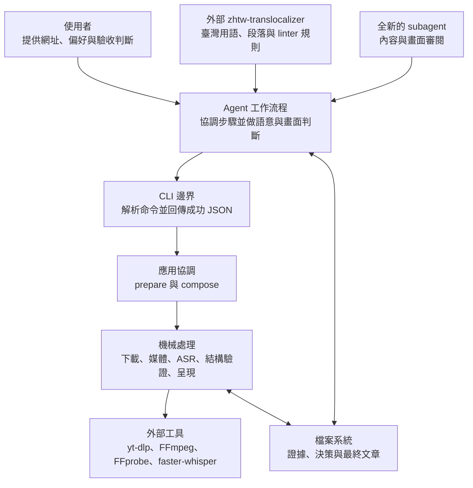
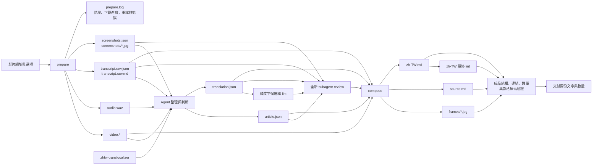
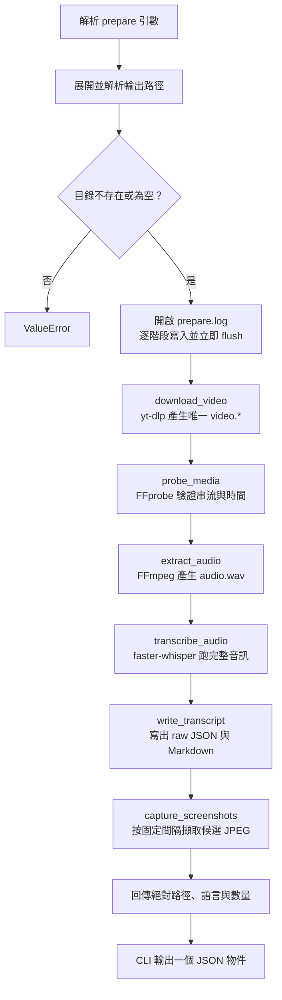
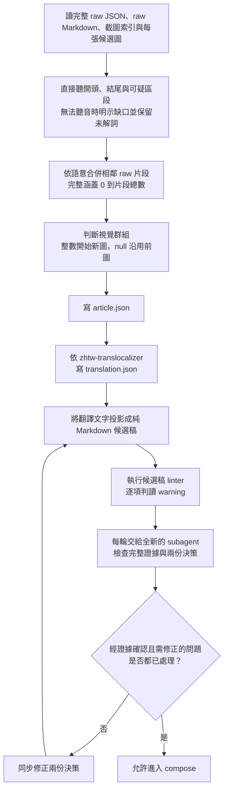
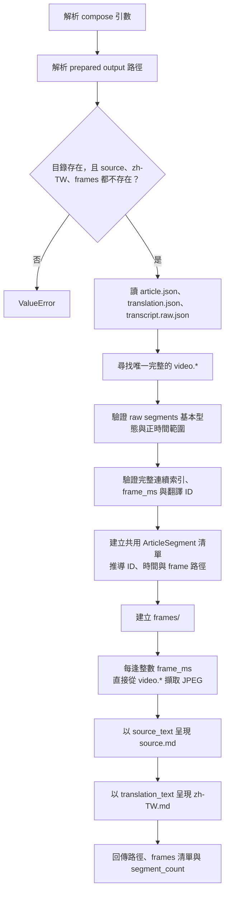
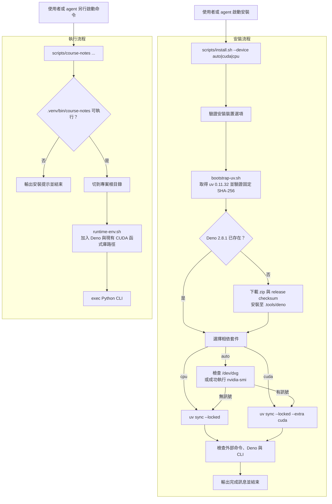

# Course Notes 架構

Course Notes 是一套本機 agent 工具。 使用者提供一個影片網址後，工具會下載影片與音訊、跑完整音訊的語音辨識、準備候選截圖，再由 agent 整理逐字稿、決定段落與畫面，最後產生原文版與臺灣繁體中文版 Markdown

這個專案刻意維持小型架構。 Python 與 shell 程式負責可重現的機械工作，agent 負責需要理解語意或畫面的判斷。 兩邊透過少量 JSON 檔案交接，不引入服務、資料庫、工作佇列或額外的應用程式層

本文說明目前實作的責任邊界、資料流、程式流程、檔案契約與已知限制。 執行中的課程輸出、測試資料、plan 與 spec 都不是執行期架構的一部分，因此不列入專案結構

## 設計摘要

完整流程分成三個階段：

1. `prepare` 將網址轉成可供判讀的影片、音訊、原始逐字稿與候選截圖
2. agent 讀完整證據，寫出 `article.json` 與 `translation.json`
3. `compose` 驗證這兩份決策，擷取最終影格，再以相同結構產生 `source.md` 與 `zh-TW.md`

核心原則如下：

- 一次處理一個影片網址，並要求使用新的空輸出目錄
- 下載、轉檔、語音辨識、結構驗證與 Markdown 呈現由程式完成
- 逐字稿修正、語意分段、畫面意義、翻譯與內容審閱由 agent 完成
- 所有原始語音辨識片段都必須依原順序被文章區段完整涵蓋
- 原文版與翻譯版共用區段 ID、時間範圍、畫面邊界、圖片路徑與排列順序
- `compose` 只執行明確決策，不推測兩張圖是否相似，也不自行決定何時換圖

## 專案結構

下圖涵蓋正式程式、skill、執行腳本與設定檔。 `docs/architecture.md` 是本文件本身

```mermaid
flowchart TB
    repo["course-notes/"]

    repo --> agent_dir[".agents/skills/course-notes/"]
    agent_dir --> skill["SKILL.md"]
    agent_dir --> agent_meta["agents/openai.yaml"]

    repo --> scripts_dir["scripts/"]
    scripts_dir --> install["install.sh"]
    scripts_dir --> install_body["lib/install-body.sh"]
    scripts_dir --> bootstrap_uv["bootstrap-uv.sh"]
    scripts_dir --> runtime_env["lib/runtime-env.sh"]
    scripts_dir --> launcher["course-notes"]
    scripts_dir --> uv_wrapper["uv"]
    scripts_dir --> versions["versions.env"]

    repo --> package_dir["src/course_notes/"]
    package_dir --> init["__init__.py"]
    package_dir --> module_entry["__main__.py"]
    package_dir --> cli["cli.py"]
    package_dir --> pipeline["pipeline.py"]
    package_dir --> download["download.py"]
    package_dir --> media["media.py"]
    package_dir --> transcribe["transcribe.py"]
    package_dir --> article["article.py"]

    repo --> docs_dir["docs/"]
    docs_dir --> architecture["architecture.md"]

    repo --> readme["README.md"]
    repo --> pyproject["pyproject.toml"]
    repo --> lock["uv.lock"]
    repo --> python_version[".python-version"]
    repo --> gitignore[".gitignore"]
```



### 各檔案的責任

| 檔案 | 責任 | 不負責的事項 |
| --- | --- | --- |
| `.agents/skills/course-notes/SKILL.md` | 定義 agent 從網址到雙語逐字稿的完整操作流程、證據閱讀、翻譯、lint、審閱與交付條件 | 不實作下載、轉檔、語音辨識或最終 Markdown 呈現 |
| `.agents/skills/course-notes/agents/openai.yaml` | 提供 skill 的顯示名稱、簡介與預設提示 | 不控制實際流程或資料契約 |
| `README.md` | 提供使用者安裝、命令與輸出格式的快速入口 | 不取代完整的架構與失敗邊界說明 |
| `scripts/install.sh` | 解析安裝時的 `--device`，再進入實際安裝腳本 | 不判斷執行某支影片時應使用哪個裝置 |
| `scripts/lib/install-body.sh` | 安裝 Deno、選擇 CPU 或 CUDA 相依套件、執行 `uv sync --locked` 與安裝後檢查 | 不執行課程處理流程 |
| `scripts/bootstrap-uv.sh` | 下載並驗證固定版本的 uv，保護 uv 替換時的舊版本 | 不管理 Python 套件內容 |
| `scripts/versions.env` | 固定 uv、Deno、平台目標與 uv 封存檔雜湊 | 不保存執行期狀態 |
| `scripts/uv` | 將引數原封不動地交給專案內的 uv | 不自行安裝 uv |
| `scripts/course-notes` | 確認 `.venv` 入口存在、切到專案根目錄、載入執行環境並啟動 CLI | 不解析 `prepare` 或 `compose` 的業務引數 |
| `scripts/lib/runtime-env.sh` | 將 Deno 與已安裝的 NVIDIA 函式庫目錄加入搜尋路徑 | 不驗證 GPU 或在執行失敗時切換 CPU |
| `src/course_notes/cli.py` | 定義 `prepare`、`compose` 命令，分派呼叫並在成功時輸出一個 JSON 物件 | 不處理語意與內容品質 |
| `src/course_notes/pipeline.py` | 驗證輸出目錄、依固定順序協調準備流程，並將階段與錯誤寫入 `prepare.log` | 不實作個別媒體操作 |
| `src/course_notes/download.py` | 用 yt-dlp 下載一份完整的 `video.*` | 不處理認證、播放清單批次或站台專用重試策略 |
| `src/course_notes/media.py` | 探測媒體、擷取 WAV、擷取 JPEG、計算固定間隔的候選截圖時間 | 不判斷畫面是否有教學意義 |
| `src/course_notes/transcribe.py` | 設定 faster-whisper、跑完整音訊的語音辨識並寫出原始逐字稿 | 不修正文句、分文章段落或翻譯 |
| `src/course_notes/article.py` | 驗證 agent 決策、推導對齊資料、擷取最終影格並呈現兩份 Markdown | 不比較畫面、不檢查翻譯忠實度，也不修正逐字稿 |
| `src/course_notes/__main__.py` | 支援 `python -m course_notes` | 不增加另一套 CLI 行為 |
| `src/course_notes/__init__.py` | 保存套件版本 `0.1.0` | 不載入執行期元件 |
| `pyproject.toml` | 定義 Python 版本、套件相依性、選用 CUDA 相依性、CLI 入口與開發工具設定 | 不固定外部 FFmpeg 版本 |
| `uv.lock` | 保存 Python 相依套件的解析結果 | 不代表所有平台與選用套件都會被安裝 |
| `.python-version` | 指定 Python 3.12 | 不固定 Python 修補版本 |
| `.gitignore` | 排除本機工具、虛擬環境、模型快取，以及 `courses/` 與 `runs/` 內的課程輸出 | 不負責清理這些檔案，也不會自動排除使用者指定在其他位置的輸出 |

## 分層與責任邊界



上層只透過下一層公開的介面工作。 agent 透過 CLI 啟動機械流程，並透過 JSON 檔案交付語意決策。 它不需要操作 faster-whisper 內部狀態、FFmpeg codec 或 GPU 函式庫。 相對地，Python 程式也不跨過決策邊界去猜測段落意思、判斷投影片是否相似或改寫翻譯

### 程式負責的判定

- 輸出目錄是否不存在或為空
- 是否得到唯一且非空的 `video.*`
- 媒體是否同時含音訊與影片串流，時間長度是否為正值
- WAV 是否為單聲道、16 kHz、16 位元 PCM
- JPEG 是否存在、非空且可由 OpenCV 解碼
- 原始逐字稿與決策 JSON 的基本型態
- 文章區段是否以連續的半開索引範圍完整涵蓋所有原始片段
- `frame_ms` 是否位於對應文章區段內
- 翻譯 ID 是否與推導出的文章 ID 完全相同且順序一致
- 原文與譯文是否能用同一組區段資料呈現

### Agent 負責的判定

- 原始語音辨識文字是否可信，以及疑似錯誤處應如何修正
- 哪些相鄰話語屬於同一個可讀段落
- `source_text` 是否保留所有口語內容、題外話、重複與不確定語氣
- 投影片、條列、公式或圖表的變化是否值得開始新的視覺群組
- 新影格應取自區段內的哪個毫秒時間點
- 哪些段落沿用上一張圖，避免同一張投影片產生過多近似圖片
- 數學內容是否應以證據支持的 LaTeX 表示
- 翻譯是否忠實、自然並符合臺灣繁體中文用語
- linter 警告是真問題還是受時間列、區段標記等必要結構影響的誤判
- 審閱意見是否有證據支持，以及修改後是否需要另一位全新 reviewer

這條邊界讓程式保持小而明確。 若一項需求需要理解「這句話的意思」或「這張圖是否值得保留」，預設由 agent 處理。 若一項需求能由檔案、索引、時間或型態客觀驗證，才適合放進 Python 核心

## 對外入口

安裝後的正式入口是 `scripts/course-notes`。 這個 wrapper 會先切換到專案根目錄，因此預設的模型快取會穩定落在 `.cache/course-notes/models`

```bash
scripts/course-notes prepare VIDEO_URL --output /absolute/path/to/output \
  --language auto --device auto --screenshot-interval 30
```

```bash
scripts/course-notes compose --output /absolute/path/to/output \
  --article /absolute/path/to/output/article.json \
  --translation /absolute/path/to/output/translation.json
```

套件也支援產生出的 `.venv/bin/course-notes` 與 `python -m course_notes`。 這兩個入口會進入相同的 Python CLI 邏輯，但會略過 wrapper 設定的專案工作目錄、Deno `PATH` 與 CUDA 函式庫路徑。 直接執行時，模型快取位置可能不同，yt-dlp 的 Deno extractor 或 CUDA 也可能因環境未設定而無法使用

`prepare` 與 `compose` 成功時只向標準輸出寫一個 UTF-8 JSON 物件並回傳狀態碼 `0`。 `--help` 與 `--version` 則輸出一般文字。 引數錯誤由 `argparse` 處理。 下載、媒體、模型或檔案錯誤不會轉成另一種錯誤 JSON，而是直接以例外與非零狀態結束

## 端到端資料流



候選截圖的路徑在圖中只進入 agent 與 reviewer。 `compose` 不讀取 `screenshots.json`，也不複製候選 JPEG。 它會依 `article.json` 的整數 `frame_ms`，直接從 `video.*` 重新擷取最終影格

## `prepare` 程式流程

`course_notes.pipeline.prepare()` 是準備階段唯一的協調函式。 各步驟固定依序執行，前一步失敗後不會繼續



### 下載

`download_video()` 直接將使用者網址交給 yt-dlp。 主要選項如下：

- `noplaylist=True`，一次只處理一支影片
- `ignoreconfig=True`，不讀取使用者的 yt-dlp 組態
- `cachedir=False`，停用 yt-dlp 的內部快取
- `format="bv*+ba/b"`，優先下載最佳影片與音訊後合併，無法分流時改用單一最佳格式
- `merge_output_format="mkv"`，需要合併時輸出 MKV
- `outtmpl="video.%(ext)s"`，最後副檔名由實際媒體格式決定
- `retries=10` 與 `fragment_retries=10`，交由 yt-dlp 重試下載與片段傳輸

下載完成後，程式只接受一個非 `.part`、非空、一般檔案的 `video.*`。 URL 解析、支援站台與實際下載行為由 yt-dlp 提供，專案沒有 Bilibili 專用 parser，也沒有另一套站台路由層

`prepare.log` 會記錄各階段開始與完成、下載進度、重試訊息及失敗原因。 每次寫入都立即 flush，agent 可在作業耗時較久時查看目前階段。 ASR 階段只記錄開始、完成或失敗，不提供逐片段進度

### 媒體探測與音訊

`probe_media()` 透過 FFprobe 讀取 JSON，確認至少有一條影片串流、一條音訊串流與正值時間長度。 `extract_audio()` 再透過 FFmpeg 產生以下固定格式：

- PCM signed 16-bit little-endian
- 單聲道
- 16 kHz 取樣率
- 檔名固定為 `audio.wav`

程式會使用 Python `wave` 模組重新開啟 WAV，確認實際 profile 與要求相符

### 語音辨識

`transcribe_audio()` 使用固定模型 `Systran/faster-whisper-large-v3`，並採用以下設定：

| 項目 | 目前值 |
| --- | --- |
| `beam_size` | `5` |
| `vad_filter` | `False` |
| `word_timestamps` | `False` |
| `condition_on_previous_text` | `False` |
| CPU `compute_type` | `int8` |
| CUDA `compute_type` | `float16` |
| auto `compute_type` | `default` |

`language=auto` 會讓模型判斷語言，其他字串則直接傳給 faster-whisper。 CLI 不另外驗證語言識別碼。 產生器會完整消耗後才建立 `TranscriptResult`，空白片段會被略過

`prepare` 的 ASR 流程會把完整的 `audio.wav` 傳給模型

skill 要求 agent 在片段可疑時，另行重新辨識該段，並採用適合的設定

Python CLI 未提供時間區間或 VAD 子命令，因此 agent 需要為單次執行另行選用工具

### 候選截圖

`screenshot_times()` 先選取 `min(500, duration_ms - 1)`，之後加入每個固定間隔且嚴格小於影片終點的時間。 預設間隔為 30 秒，所有時間會排序並去除重複

候選檔名同時包含順序與毫秒時間，例如 `screenshots/0001-000000500.jpg`。 這些畫面只提供 agent 掃描內容與尋找視覺變化，不直接決定最終文章會有幾張圖

## 準備階段的輸出契約

```text
output/
├── prepare.log
├── video.<actual-extension>
├── audio.wav
├── transcript.raw.json
├── transcript.raw.md
├── screenshots.json
└── screenshots/
    ├── 0001-000000500.jpg
    └── ...
```

### `transcript.raw.json`

```json
{
  "language": "en",
  "language_probability": 0.99,
  "segments": [
    {
      "start_ms": 0,
      "end_ms": 1200,
      "text": " Raw ASR text"
    }
  ]
}
```

`segments` 的索引是後續文章決策的對齊基準。 `transcript.raw.md` 則把相同資料寫成每個原始片段一行，方便 agent 完整閱讀：

```text
[00:00:00.000 – 00:00:01.200]  Raw ASR text
```

### `screenshots.json`

```json
[
  {
    "path": "screenshots/0001-000000500.jpg",
    "time_ms": 500
  }
]
```

這份索引沒有 `schema_version`。 路徑相對於輸出目錄，`time_ms` 是候選影格在影片中的毫秒位置

### 成功結果

`prepare` 的成功 JSON 包含：

- `output`
- `video`
- `audio`
- `transcript_json`
- `transcript_markdown`
- `screenshots_json`
- `screenshots`
- `language`
- `transcript_segment_count`
- `screenshot_count`

所有檔案路徑都會轉成絕對路徑

## Course Notes skill 的協調契約

`.agents/skills/course-notes/SKILL.md` 是完整 agent 流程的入口。 它不包含另一份媒體實作，而是規定 agent 應如何使用 CLI、閱讀證據、製作決策與驗證結果

開始執行時，agent 會從 `SKILL.md` 所在位置向上尋找，同時含有 `pyproject.toml` 與可執行 `scripts/course-notes` 的目錄，並將它視為專案根目錄。 預設的語言、裝置與截圖間隔分別是 `auto`、`auto` 與 30 秒

載入外部 `zhtw-translocalizer` 後，agent 必須找出該 skill 的 `SKILL.md` 所在目錄，並在候選稿與最終稿兩次 lint 前將其絕對路徑設為 `ZHTW_SKILL_ROOT`。 Course Notes installer 不會安裝這個外部 skill，也不會設定該變數

自動安裝與重試有明確上限：

- 只有 wrapper 完整輸出 `course-notes: run scripts/install.sh first` 時，才允許自動安裝
- `scripts/install.sh --device ...` 最多執行一次
- 完全相同的 `prepare` 命令最多重跑一次
- 其他錯誤不觸發反覆安裝或通用重試

這些規則屬於 agent 的操作政策，不是 Python API 內的狀態機。 直接呼叫 CLI 時，程式只會執行收到的單一命令

## Agent 整理流程

準備階段只產生證據。 正式文章的段落、文字與視覺群組都在 agent 階段決定



reviewer 必須對每筆原始話語逐句比較 raw、原文與譯文，並以 raw 索引、區段 ID、短引文與證據回報問題。 檢查涵蓋逐字稿完整性、段落密度、術語、LaTeX、標點、臺灣用語、重要畫面遺漏與重複畫面。 linter 只提供表面訊號與重讀提示，不能證明內容忠實，也不能取代 reviewer

正式 review 前，agent 會把 `translation.json` 的文字依序投影到輸出目錄外的暫存 Markdown，各段之間留一個空行，且不混入 JSON、圖片、時間或區段標記。 每一項 linter warning 都要依上下文確認。 真正的 `L020` 要在相鄰 raw 話語邊界同步拆分原文與翻譯決策，只有不可再拆分的單一話語或公式，經全新 reviewer 確認後才可保留

### `article.json`

```json
{
  "schema_version": 1,
  "segments": [
    {
      "transcript_start": 0,
      "transcript_end": 12,
      "frame_ms": 500,
      "source_text": "Readable source-language transcript text."
    },
    {
      "transcript_start": 12,
      "transcript_end": 18,
      "frame_ms": null,
      "source_text": "The next complete prose paragraph."
    }
  ]
}
```

程式會執行以下結構驗證：

- `schema_version` 必須是整數 `1`
- `segments` 不得為空
- 第一段必須從 raw 索引 `0` 開始
- 每段使用非空的半開範圍 `[transcript_start, transcript_end)`
- 下一段必須從上一段的 `transcript_end` 開始
- 最後一段必須剛好結束於 raw 片段總數
- 區段 ID 依位置推導成 `segment-0001`、`segment-0002`，依此類推
- 區段開始時間取第一個 raw 片段的 `start_ms`
- 區段結束時間取最後一個 raw 片段的 `end_ms`
- 第一段的 `frame_ms` 必須是整數
- 後續 `frame_ms` 可為區段內的整數，或用 `null` 沿用上一個視覺群組
- `source_text` 必須是非空的單一實體行，不得加入圖片、區段註解或被黑名單擋下的 Markdown block 開頭

程式不會比較 `source_text` 與 raw 文字的語意。 即使索引完整，agent 仍可能在改寫時漏字，因此內容完整性必須靠證據閱讀與 review 確認

### 視覺群組

整數 `frame_ms` 代表這個文章區段開始新的視覺群組。 `null` 代表繼續沿用最近一個群組的圖片。 最終圖片數等於整數 `frame_ms` 的數量，不等於文章段落數

以下變化通常值得開始新群組：

- 切換投影片
- 新的關鍵條列出現
- 公式推導出現新的必要步驟
- 圖表或示意圖增加會影響理解的內容

游標移動、講者移動、壓縮雜訊與純裝飾動畫不應開始新群組。 同一張投影片講了多個自然段落時，後續段落使用 `frame_ms: null`，就能保留逐字稿分段，同時避免產生多張近似圖片

### `translation.json`

```json
{
  "schema_version": 1,
  "items": [
    {
      "segment_id": "segment-0001",
      "text": "忠實且自然的臺灣繁體中文逐字稿。"
    },
    {
      "segment_id": "segment-0002",
      "text": "下一個完整段落。"
    }
  ]
}
```

`items` 的數量、ID 與順序必須和 `article.json` 推導出的區段完全相同。 文字欄位與 `source_text` 採相同的單行及結構限制。 翻譯忠實度、術語、標點、段落節奏與 LaTeX 仍由 agent、`zhtw-translocalizer` 與 reviewer 共同把關

目前沒有獨立的 JSON Schema 檔。 上述範例、skill 指令與 `article.py` 的 validator 共同構成實際契約。 物件中的未知欄位會被忽略，不應依賴它們影響呈現結果

## `compose` 程式流程

`compose_articles()` 先完成所有 JSON 與區段驗證，再建立最終輸出。 不過影格擷取與檔案寫入仍是逐步進行，並非交易式操作



`ArticleSegment` 是兩份文章共用的內部資料結構，包含：

- `segment_id`
- `start_ms`
- `end_ms`
- `frame_ms`
- `frame_path`
- `source_text`
- `translation_text`

同一份物件清單分別以 `source_text` 與 `translation_text` 呈現，因此兩個 Markdown 的區段標記、時間、圖片位置與順序不會各自漂移

### 最終 Markdown 格式

開始新視覺群組的區段如下：

```md
<!-- segment:segment-0001 -->


時間：00:00:00.000–00:00:05.000

Paragraph text.
```

沿用上一張圖的區段如下：

```md
<!-- segment:segment-0002 -->

時間：00:00:05.000–00:00:10.000

Paragraph text.
```

每個區段都只有一個正文段落。 圖片只出現在視覺群組的第一段，延續段落的有效圖片是前面最近一次出現的群組圖片

### 成功結果

`compose` 的成功 JSON 包含：

- `output`
- `source`
- `translation`
- `frames`
- `segment_count`

回傳值沒有獨立的 `frame_count`。 agent 以 `frames` 陣列長度計算最終影格數量

### 最終驗證與交付

`compose` 成功後，skill 要求 agent 再確認：

- 兩份 Markdown 的區段標記、時間、圖片路徑、視覺群組邊界與順序完全相同
- 每個區段只有一個正文段落，區段外沒有額外的逐字稿段落
- 正文段落數等於 `segment_count`
- 圖片連結數、`frames` 回傳陣列長度與視覺群組數相同
- `frames/` 中每個 JPEG 都可解碼，而且所有 Markdown 圖片連結都存在
- 最終翻譯沒有新增候選稿 review 時未處理的 `L020` 段落密度警告

最終翻譯會再執行一次外部 skill 的 Python linter：

```bash
python3 "$ZHTW_SKILL_ROOT/linter/lint.py" --profile final --format markdown "$OUTPUT/zh-TW.md"
```

這個入口需要 Python 3.10 以上。 linter 預設只回報警告，因此狀態碼 `0` 不代表警告已解決，agent 仍須逐項判讀。 完成後要回傳 `source.md` 與 `zh-TW.md` 的直接連結、區段數、影格數與 lint 結果

## 完整輸出目錄

```text
output/
├── prepare.log
├── video.<actual-extension>
├── audio.wav
├── transcript.raw.json
├── transcript.raw.md
├── screenshots.json
├── screenshots/
│   └── ...
├── article.json
├── translation.json
├── source.md
├── zh-TW.md
└── frames/
    └── ...
```

檔案可依生命週期分成三類：

| 類型 | 檔案 | 擁有者 |
| --- | --- | --- |
| 準備證據與執行紀錄 | `prepare.log`、`video.*`、`audio.wav`、`transcript.raw.*`、`screenshots.json`、`screenshots/*.jpg` | `prepare` |
| 語意決策 | `article.json`、`translation.json` | agent |
| 最終成品 | `frames/*.jpg`、`source.md`、`zh-TW.md` | `compose` 根據 agent 決策產生 |

準備證據會保留在輸出目錄中，方便追查逐字稿與畫面決策。 `compose` 不會刪除或改寫準備檔案

## 安裝與執行環境



### 安裝內容

- Python 版本限制為 `>=3.12,<3.13`
- uv 固定為 `0.11.32`，下載封存檔以專案內的 SHA-256 驗證
- Deno 固定為 `2.8.1`，供 yt-dlp 的 JavaScript extractor 使用
- Python 基本相依套件為 faster-whisper、OpenCV 與 yt-dlp
- `cuda` extra 會加入 NVIDIA CUDA 12 的 cuBLAS 與 cuDNN 套件
- Python CLI 與 installer 仍需系統提供 Bash、curl、sha256sum、tar、unzip、FFmpeg、FFprobe，以及腳本使用的 GNU core utilities，例如 `mv -T`、`mktemp`、`chmod`、`mkdir` 與 `rm`
- 完整 agent 流程另外需要外部 `zhtw-translocalizer` skill，以及 Python 3.10 以上，以執行其 `linter/lint.py`。 Course Notes installer 不會安裝或固定該外部 skill 的版本

安裝腳本下載的是 `x86_64-unknown-linux-gnu` 版本，並使用 GNU/Linux 的路徑與命令語意。 因此目前的安裝流程是 GNU/Linux x86-64 專用，不是跨平台 installer

對外部系統命令而言，安裝後檢查目前只明確探測 Bash、curl、sha256sum、unzip、FFmpeg 與 FFprobe。 它會另外驗證固定版本的 Deno 與 `.venv/bin/course-notes --version`。 `tar` 或其他基礎命令若缺少，會在較早的實際操作中直接失敗，不會得到同一份友善的缺少命令訊息

### CPU 與 CUDA 的兩個選擇點

安裝時的 `--device` 決定 `.venv` 是否安裝 CUDA extra。 `auto` 只根據 `/dev/dxg` 或可成功執行的 `nvidia-smi` 做啟發式判斷，不會測試完整 CUDA ABI 或實際載入模型

執行 `prepare` 時的 `--device` 是另一個獨立選項，會直接傳給 `WhisperModel`。 執行 wrapper 只加入已存在的 cuBLAS 與 cuDNN 目錄，不會偵測裝置、不會記住安裝選擇，也不會在 CUDA 失敗後自動改用 CPU

## 快取與本機狀態

這個專案沒有用 URL 結果快取跳過下載。 yt-dlp 的 `cachedir` 明確設為 `False`，每個新的輸出目錄都會重新取得該次媒體

專案仍保留幾種用途不同的本機狀態：

| 路徑 | 用途 | 是否為課程輸出 |
| --- | --- | --- |
| `.tools/uv/` | 專案固定版本的 uv | 否 |
| `.tools/deno/` | 專案固定版本的 Deno | 否 |
| `.venv/` | uv 管理的 Python 環境與 CLI | 否 |
| `.cache/course-notes/models/` | faster-whisper 模型權重，避免每次重抓大型模型 | 否 |
| 使用者或工具的預設快取目錄 | uv、Hugging Face 或 Deno 可能使用的上游快取，專案沒有另外指定位置 | 否 |
| 使用者指定的 `output/` | 單支影片的證據、決策與最終文章 | 是 |

`.tools/`、`.venv/` 與 `.cache/` 由 `.gitignore` 排除。 專案也會排除 `courses/*` 與 `runs/`，但使用者指定在其他位置的輸出不一定會被忽略。 模型快取只重用模型權重，不會重用逐字稿、影片或截圖

## 失敗與重跑邊界

目前實作採直接、線性的檔案流程，沒有交易、rollback、resume 或跨程序鎖定。 這符合本機 agent 工具的定位，但除錯時必須知道失敗可能留下哪些檔案

### `prepare`

- 一開始只接受不存在或完全空白的輸出目錄
- 處理順序是影片、探測、音訊、ASR、逐字稿、候選截圖
- 任一步驟失敗都可能留下先前已完成的檔案
- 因為輸出目錄已非空，直接用同一路徑重跑通常會先被目錄檢查擋下
- `screenshot_interval` 的正值檢查發生在候選截圖階段，錯誤值可能在下載與 ASR 完成後才失敗
- 語音辨識結果可以暫時為零個片段，但 `compose` 會拒絕空的 raw segment 清單

agent 應先檢查錯誤與已留下的成品，再選擇新的輸出目錄或針對該次執行處理殘留檔案。 核心程式不自動猜測哪些部分適合保留

### `compose`

- 一開始要求 prepared 目錄存在，且 `source.md`、`zh-TW.md`、`frames/` 都尚未存在
- JSON、raw segments、唯一影片、索引涵蓋與翻譯 ID 會在建立最終輸出前驗證
- 通過驗證後會先建立 `frames/`，再逐張擷取影格，最後依序寫 `source.md` 與 `zh-TW.md`
- 影格或檔案寫入途中失敗時，可能留下部分 `frames/` 或單一 Markdown
- 這些殘留會讓同一路徑的下一次 `compose` 被前置檢查擋下

### Installer

- 所有 shell 腳本都使用 `set -euo pipefail`
- uv 替換流程會先備份舊目錄，發布或驗證失敗時嘗試還原
- Deno 替換沒有相同的舊版本還原流程
- `uv sync` 或安裝後檢查失敗時，已下載的工具與部分 `.venv` 狀態會保留
- 同時執行多個 installer 可能互相影響，腳本沒有安裝鎖

## 結構保證與語意保證

下表可用來判斷問題應該由哪一層處理：

| 問題 | 程式能否保證 | 正確擁有者 |
| --- | --- | --- |
| 每個 raw 索引被決策範圍涵蓋一次 | 可以 | `article.py` |
| `source_text` 實際保留每一句話 | 不可以 | agent 與 reviewer |
| 原文與譯文區段數及順序相同 | 可以 | `article.py` |
| 翻譯忠實且使用自然的臺灣用語 | 不可以 | `zhtw-translocalizer`、agent 與 reviewer |
| 每個整數 `frame_ms` 位於區段時間內 | 可以 | `article.py` |
| 選到的畫面正好呈現重要內容 | 不可以 | agent 與 reviewer |
| 近似投影片不會重複開始群組 | 不可以 | agent 與 reviewer |
| 最終 JPEG 可解碼 | 可以 | `media.py` |
| raw ASR 片段依時間排序且互不重疊 | 目前不可以 | 上游 ASR 與 agent 證據檢查 |
| 文字內的數學公式忠於語音與畫面 | 不可以 | agent 與 reviewer |

這個區分也解釋了為何結構測試無法取代實際輸出檢查。 程式可以證明索引、ID、時間與檔案形狀一致，但逐字稿與畫面的正確性仍要由理解內容的 agent 或使用者判斷

## 已知限制

- 一次只處理一支影片，不提供播放清單批次介面
- 下載層沒有 cookies、登入或其他認證介面
- 站台相容性取決於目前安裝的 yt-dlp 與 Deno extractor
- ASR 模型固定，沒有 CLI 參數切換模型
- ASR 沒有時間區間、word timestamp、VAD 或自動重試介面
- 候選截圖採固定間隔，不執行鏡頭變化偵測。 agent 可直接檢查影片來補足候選圖不足的情況
- `compose` 不讀候選截圖、不衡量圖片相似度，也不驗證段落內容與 raw 語音是否相同
- raw segment 只驗證個別正時間範圍，不驗證整體排序、重疊或是否超出影片長度
- JSON 契約由範例與 Python validator 定義，沒有獨立的 machine-readable schema
- prepare 與 compose 都可能留下部分輸出，沒有內建 resume 或 rollback
- `auto` CUDA 判斷只是一項安裝與模型執行的啟發式，不能保證主機上的 CUDA 執行環境完整
- `zhtw-translocalizer` 是主機上另行載入的外部 skill，不由本專案安裝或固定版本
- Python linter 預設只輸出 warning。 它不會修改文字，也不能單獨證明翻譯或逐字稿正確

這些限制大多保留給 agent 依單次任務處理。 只有當某個問題能穩定重現、具有清楚的機械判準，並且無法合理地由 agent 判斷時，才值得擴充核心程式

## 變更時應修改哪裡

| 想改的行為 | 主要修改位置 | 需要同步檢查 |
| --- | --- | --- |
| CLI 引數或成功 JSON | `cli.py`、對應核心函式 | README、skill 與本文的命令契約 |
| 下載格式或 yt-dlp 行為 | `download.py` | 唯一 `video.*` 契約、外部 extractor 需求 |
| 媒體驗證、WAV 或 JPEG | `media.py` | pipeline 呼叫、輸出契約與 compose 影格 |
| prepare 的步驟順序 | `pipeline.py` | 部分失敗行為與 skill 操作順序 |
| ASR 模型或推論參數 | `transcribe.py` | 模型快取、CPU/CUDA 相依性與逐字稿契約 |
| 文章或翻譯 JSON 格式 | `article.py` | Course Notes skill、README、本文範例與既有決策檔 |
| 區段標記、時間列或圖片版面 | `article.py` 的 `_render()` | 兩種語言的結構對齊、skill 最終驗證與 linter 判讀 |
| 分段、畫面或逐字稿內容政策 | `.agents/skills/course-notes/SKILL.md` | 不應把純語意規則塞入 Python validator |
| 臺灣用語、翻譯文風或 linter 規則 | 外部 `zhtw-translocalizer` | Course Notes skill 的呼叫與 lint gate |
| 安裝版本與 Python 相依性 | `scripts/versions.env`、`pyproject.toml`、`uv.lock` | bootstrap 驗證、CPU/CUDA 安裝與 runtime path |

## 除錯索引

遇到問題時，可從最接近症狀的責任單元開始：

| 症狀 | 先檢查 |
| --- | --- |
| 網址無法下載或抓到錯的分集 | `download.py` 傳給 yt-dlp 的原始 URL，以及 yt-dlp 的 extractor 輸出 |
| 影片下載成功但缺少音訊或時間 | `media.py` 的 FFprobe 結果 |
| 音訊無法供 ASR 使用 | `audio.wav` profile 與 `extract_audio()` |
| 逐字稿尾端缺失或內容可疑 | 實際 `audio.wav` 長度、`transcript.raw.json` 尾端與 `transcribe.py` 設定 |
| 前幾段或題外話消失 | `article.json` 的 raw 範圍與 `source_text`，再對照完整 raw transcript |
| 同一張投影片產生太多圖片 | `article.json` 的整數 `frame_ms` 是否過多，應沿用畫面的段落是否改成 `null` |
| 重要投影片變化沒有圖片 | 候選圖與影片中的實際變化位置，以及對應段落是否開始新的整數 `frame_ms` |
| 原文與譯文結構不同 | `translation.json` ID，或 `article.py` 的共用呈現流程 |
| 繁體中文段落過長或用語不自然 | `translation.json`、`zhtw-translocalizer` linter warning 與 fresh review |
| compose 無法重跑 | 輸出目錄中是否已有 `frames/`、`source.md` 或 `zh-TW.md` 的部分結果 |
| CUDA 模型載入失敗 | 安裝時是否含 CUDA extra、runtime library path 與主機 CUDA 可用性。 需要時以明確 `--device cpu` 重新建立相符環境與新輸出 |

## 維持架構簡潔的判準

新增元件前，先確認目前的責任層是否已能處理需求：

- 單次網址或站台的特殊狀況，優先讓 agent 用普通工具診斷
- 需要理解語意、逐字稿或投影片內容的規則，留在 skill 與 review
- 能由固定輸入得到固定輸出的媒體或結構操作，放在小型 Python 函式
- CLI 只暴露完整流程需要的穩定參數，不替每個臨時判斷新增旗標
- JSON 邊界只承載 compose 真正需要的決策，不把 review 筆記或中介狀態塞進契約
- 只有在可重現的機械問題出現後，才新增相應的程式驗證與少量聚焦測試

依照這些判準，Course Notes 可以保留完整的逐字稿、畫面與翻譯品質要求，同時維持一個足以由 agent 理解、檢查與修正的小型程式核心
